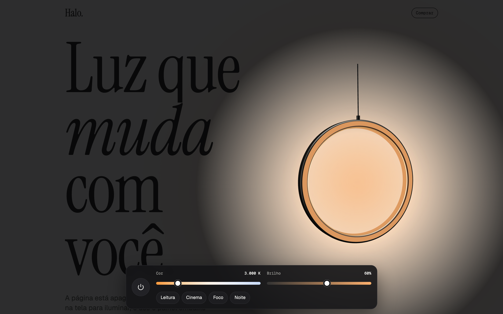
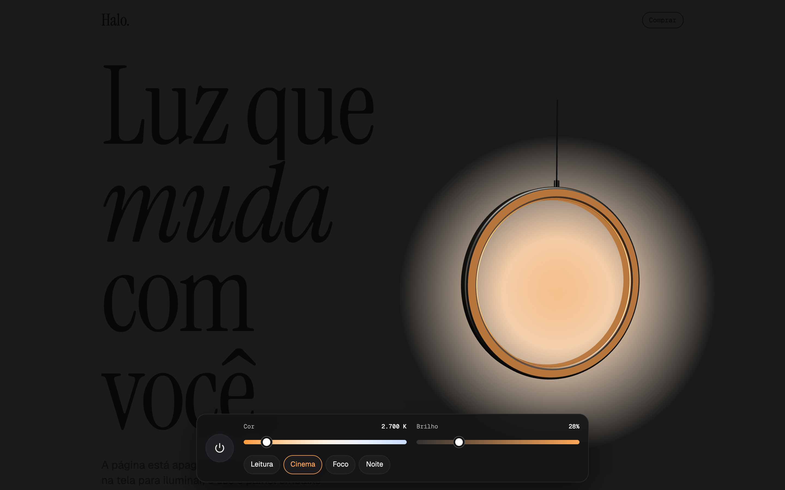
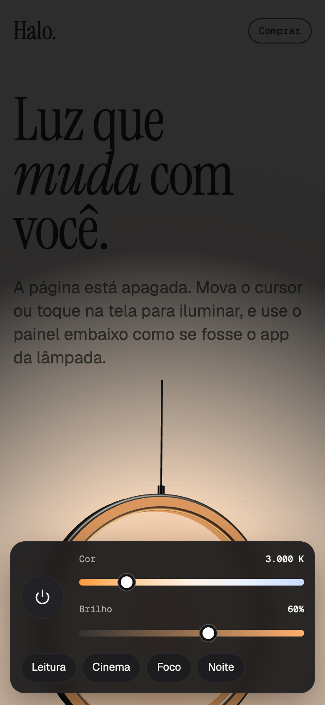
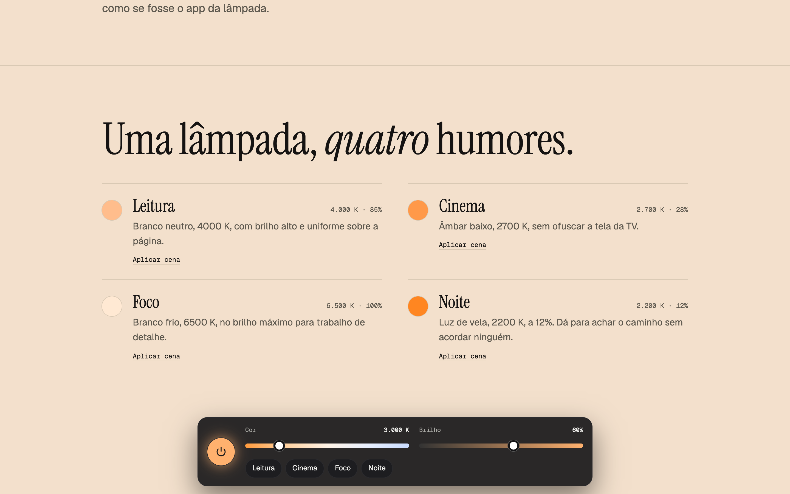

# Halo

Página de produto de uma lâmpada inteligente fictícia. A página começa apagada: um feixe de luz segue o cursor (ou o toque) e um painel fixo embaixo funciona como o app da lâmpada, mudando a cor, o brilho e a cena de verdade, na página inteira.





<p align="center">
  
  &nbsp;
  
  &nbsp;
  
</p>



## O que tem na página

- **Página apagada com feixe de luz** que segue o cursor ou o toque; antes de alguém mexer, o feixe passeia sozinho
- **Painel do app**: acender a página toda, cor de 2200 K a 6500 K, brilho de 5% a 100% e quatro cenas
- **Cenas animadas**: cor e brilho mudam suavemente, sem saltos
- **Luminária em anel, em 3D**: aro de alumínio, difusor que emite a cor exata em kelvin, luz interna que ilumina o aro, e o conjunto girando e balançando no cabo
- **Humores e escala de cor clicáveis**: cada cena ou faixa de kelvin aplica aquela luz na hora
- **Ficha técnica** e preço com animação de entrada

Funciona com mouse e toque em qualquer tela, e respeita a preferência do sistema por menos movimento.

## Tecnologias

| Tecnologia                                                                                                          | Uso                                                   |
| ------------------------------------------------------------------------------------------------------------------- | ----------------------------------------------------- |
| [Next.js 16](https://nextjs.org) (App Router)                                                                       | framework, renderização estática e fontes             |
| [React 19](https://react.dev) + [TypeScript](https://www.typescriptlang.org)                                        | interface e tipagem                                   |
| [React Three Fiber](https://r3f.docs.pmnd.rs) + [three.js](https://threejs.org) + [drei](https://drei.docs.pmnd.rs) | luminária em 3D, carregada só no navegador            |
| [Motion](https://motion.dev)                                                                                        | feixe com mola, cenas animadas, entradas e transições |
| [Tailwind CSS 4](https://tailwindcss.com)                                                                           | estilos e layout responsivo                           |
| [Playwright](https://playwright.dev)                                                                                | geração dos prints deste README                       |
| ESLint + Prettier                                                                                                   | padrão de código e formatação                         |

## Como rodar

Precisa de [Node.js](https://nodejs.org) 22 ou mais recente.

```bash
npm install
npm run dev
```

Abra http://localhost:3000. Para testar no celular na mesma rede Wi-Fi, rode `npm run dev -- -H 0.0.0.0` e acesse `http://<ip-do-seu-computador>:3000`.

### Comandos

| Comando               | O que faz                                                                                       |
| --------------------- | ----------------------------------------------------------------------------------------------- |
| `npm run dev`         | servidor de desenvolvimento                                                                     |
| `npm run build`       | verifica os tipos e gera a versão de produção                                                   |
| `npm run start`       | serve a versão de produção (depois do build)                                                    |
| `npm run lint`        | ESLint                                                                                          |
| `npm run format`      | Prettier em todo o projeto                                                                      |
| `npm run check`       | testa as regras do domínio (kelvin para RGB, feixe, faixas de cor)                              |
| `npm run screenshots` | gera os prints em `docs/` (depois do build; na primeira vez, `npx playwright install chromium`) |

## Estrutura

```
src/
├── app/                   layout, página e estilos globais (Next.js)
├── domain/light.ts        regras do produto, sem React: kelvin para RGB,
│                          feixe por brilho, cenas, escala e ficha técnica
├── providers/
│   └── LightProvider.tsx  estado da luz; vira variáveis CSS lidas pela página toda
├── components/
│   ├── atoms/             PowerIcon, Counter
│   ├── molecules/         Lamp (cena 3D + reserva em CSS), Slider, SectionTitle
│   └── organisms/         Beam, ControlPanel, Nav, Hero, Moods, ColorScale, Specs, Footer
├── lib/                   utilitário cn
└── constants/             curvas de animação
```

Imports usam aliases: `@atoms/*`, `@molecules/*`, `@organisms/*`, `@domain/*`, `@providers/*`, `@lib/*`, `@constants/*`.

---

Produto fictício, criado como peça de portfólio.
